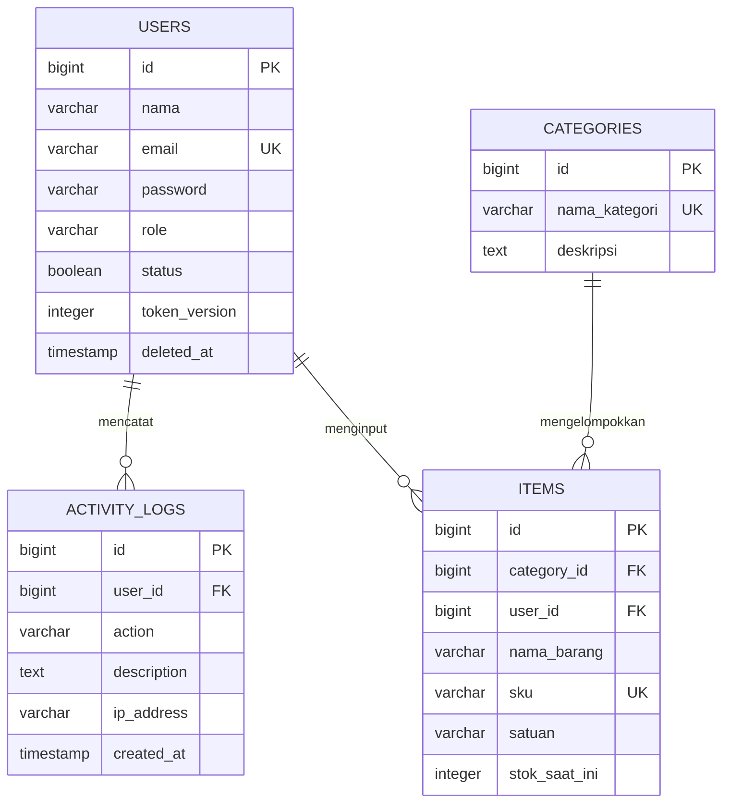

# InventoriKu

**Mata kuliah:** Pemrograman Web Dinamis 2026  
**Kelompok:** Tim BitByBit (Sedikit demi sedikit, lama-lama project-nya selesai)  
**Repositori:** [pandu2308/Projek2026PWD](https://github.com/pandu2308/Projek2026PWD)  
**Tahap:** Perencanaan Milestone 1

README ini menjadi acuan pengembangan kelompok. Struktur folder, fitur, dan hasil tugas di bawah merupakan rencana implementasi.

Tim BitByBit merencanakan aplikasi pengelolaan persediaan barang berbasis web. Dokumen ini menjadi acuan identitas kelompok, fitur awal, desain data, struktur proyek, dan pembagian pekerjaan. Target Milestone 1 adalah login, pengaturan hak akses, manajemen pengguna, profil, dan pencatatan aktivitas.

## 1 Identitas kelompok

| Nama | NIM | Peran dalam kelompok |
| --- | --- | --- |
| Pandu Pradana Putra | 2400018246 | Ketua dan pengembang backend |
| Muhammad Rivan R | 2400018262 | Pengembang frontend |
| Betrand Erlangga | 2400018294 | Pengembang database dan audit aktivitas |
| Erlangga putra A | 2400018274 | Pengembang halaman pendukung dan penguji integrasi |

Nama kelompok: Tim BitByBit. Akun GitHub proyek: pandu2308.

## 2 Rancangan aplikasi

Nama aplikasi: InventoriKu. Aplikasi ini ditujukan untuk gudang atau usaha yang membutuhkan pencatatan barang, pemantauan stok, dan pengaturan akses pengguna. Data yang dikelola dalam pengembangan berikutnya meliputi kategori, barang, stok masuk, stok keluar, dan laporan persediaan.

### Tujuan aplikasi

- Menyimpan data persediaan secara terpusat agar pencatatan barang lebih teratur.
- Membagi akses Admin, Staff Gudang, dan Manajemen sesuai pekerjaan masing-masing.
- Mencatat aktivitas pengguna agar perubahan data dapat ditelusuri.

### Batas pekerjaan Milestone 1

Tahap pertama berfokus pada akun dan akses. Pengelolaan kategori, barang, transaksi stok, dan laporan persediaan disiapkan sebagai pengembangan berikutnya. Fitur yang tercantum dalam rancangan ini merupakan target pengerjaan, belum dinyatakan selesai.

## 3 Fitur dan hak akses

| Fitur Milestone 1 | Perilaku yang direncanakan |
| --- | --- |
| Login dan logout | Pengguna aktif masuk dengan email dan password. Logout mengakhiri akses token lama. |
| Dashboard awal | Menampilkan ringkasan akun dan aktivitas sesuai hak akses. Ringkasan stok ditambahkan pada tahap inventori. |
| Manajemen pengguna | Admin menambah, melihat, mengubah, menonaktifkan, dan menghapus pengguna secara soft delete. |
| Profil pribadi | Setiap pengguna melihat profil, mengubah nama, dan mengganti password sendiri. |
| Riwayat aktivitas | Sistem mencatat login berhasil, logout, dan perubahan akun tanpa menyimpan password atau token. |

| Akses | Admin | Staff Gudang | Manajemen |
| --- | --- | --- | --- |
| Dashboard awal | Ya | Ya | Ya |
| Mengelola akun dan peran | Ya | Tidak | Tidak |
| Mengubah profil sendiri | Ya | Ya | Ya |
| Melihat riwayat aktivitas | Semua pengguna | Milik sendiri | Milik sendiri |
| Rencana tahap inventori | Kelola seluruh data | Input barang dan stok | Baca laporan |

## 4 Teknologi dan alur sistem

Backend menggunakan PHP 8.3 dan Laravel 13, REST API, serta firebase/php-jwt. Frontend menggunakan Next.js 16 App Router, React 19, TypeScript, dan Tailwind CSS v4. Database menggunakan PostgreSQL pada Supabase. Folder backend dan frontend berada dalam satu repositori.

Permintaan dari halaman Next.js diteruskan melalui route server ke API Laravel. Laravel memvalidasi data, memeriksa akses, dan mengolah PostgreSQL. Hasilnya dikembalikan untuk ditampilkan kepada pengguna.

### Rancangan autentikasi

Password disimpan sebagai hash. Laravel menerbitkan JWT dengan batas waktu berlaku setelah login berhasil. Next.js menyimpan token pada cookie HttpOnly dengan Secure saat HTTPS dan SameSite yang sesuai. Permintaan perubahan data dilindungi pemeriksaan origin atau CSRF. Token tidak disimpan di localStorage.

Setiap permintaan terlindungi diperiksa berdasarkan status akun, peran, dan token_version di database. Logout atau perubahan keamanan menaikkan token_version agar token lama ditolak pada seluruh sesi. Token kedaluwarsa mengharuskan login ulang. Rahasia JWT dan kredensial database hanya berada pada konfigurasi server.

## 5 Desain database

Semua primary key dan foreign key pengguna menggunakan BIGINT agar tipe relasinya konsisten. Tabel users dan activity_logs menjadi pekerjaan Milestone 1. Tabel categories dan items menjadi rancangan tahap inventori.

### Tabel users

| Kolom | Tipe dan fungsi |
| --- | --- |
| id | BIGINT, primary key |
| nama dan email | VARCHAR; email unik untuk identitas login |
| password | VARCHAR untuk hash password |
| role | VARCHAR dengan validasi admin, staff_gudang, atau manajemen |
| status dan token_version | BOOLEAN aktif secara default; INTEGER dengan nilai awal 1 |
| deleted_at | TIMESTAMP nullable untuk soft delete |
| created_at dan updated_at | TIMESTAMP pencatatan waktu |

### Tabel activity_logs

| Kolom | Tipe dan fungsi |
| --- | --- |
| id dan user_id | BIGINT; id sebagai primary key dan user_id merujuk users.id |
| action | VARCHAR; misalnya login, logout, create_user, dan update_profile |
| description | TEXT berisi keterangan aktivitas tanpa data rahasia |
| ip_address dan created_at | VARCHAR alamat IP dan TIMESTAMP waktu aktivitas |

### Rancangan tabel tahap inventori

| Tabel | Kolom utama |
| --- | --- |
| categories | id, nama_kategori unik, deskripsi, created_at, updated_at |
| items | id, category_id, user_id, nama_barang, sku unik, satuan, stok_saat_ini, created_at, updated_at |

Relasi: satu pengguna memiliki banyak activity_logs dan dapat mencatat banyak items. Satu kategori memiliki banyak items. Kolom category_id merujuk categories.id dan user_id merujuk users.id. Nilai stok_saat_ini tidak boleh negatif. Riwayat aktivitas tetap tersedia ketika akun dinonaktifkan atau dihapus melalui soft delete.

Transaksi stok masuk dan stok keluar memerlukan tabel riwayat transaksi tersendiri pada tahap berikutnya, supaya perubahan stok tidak hanya menimpa jumlah terakhir.

### Diagram relasi

Tabel `users` dan `activity_logs` direncanakan untuk Milestone 1. Tabel `categories` dan `items` disiapkan untuk tahap inventori.

## 6 Struktur repositori

Repositori menggunakan monorepo, yaitu satu repositori untuk backend, frontend, dan dokumentasi. Struktur berikut menjadi pedoman penempatan file saat aplikasi mulai dibuat.

| Lokasi | Isi dan fungsi |
| --- | --- |
| backend/app/Auth/ | JwtGuard untuk memeriksa identitas pengguna. |
| backend/app/Http/Controllers/Api/ | Controller autentikasi, pengguna, profil, dan aktivitas. |
| backend/app/Http/Middleware/ | Pemeriksaan token, status akun, dan hak akses. |
| backend/app/Http/Requests/ | Validasi data login dan formulir pengguna. |
| backend/app/Models/ | Model User dan ActivityLog; model inventori menyusul. |
| backend/app/Support/ | JwtService untuk penerbitan dan validasi JWT. |
| backend/app/Services/ | ActivityLogger untuk pencatatan aktivitas. |
| backend/database/ | Migrations untuk struktur database dan seeders untuk data uji. |
| backend/routes/api.php | Daftar endpoint API Laravel. |
| backend/tests/Feature/ | Pengujian login, hak akses, pengguna, dan aktivitas. |
| frontend/src/app/(auth)/login/ | Halaman login. |
| frontend/src/app/(app)/ | Halaman dashboard, users, profile, dan activity. |
| frontend/src/app/api/ | Route server untuk cookie autentikasi dan penerusan permintaan API. |
| frontend/src/components/ | Form, tabel, sidebar, dan komponen tampilan bersama. |
| frontend/src/lib/ | Klien API, tipe data, dan fungsi pendukung. |
| docs/ dan README.md | Rancangan, kontrak API, pembagian tugas, panduan menjalankan proyek, serta hasil uji. |

### Aturan isi repositori

Commit file contoh .env.example tanpa rahasia. File .env, kunci JWT, password database, node_modules, vendor, dan hasil build tidak dimasukkan ke Git. Setiap perubahan fitur dikerjakan pada branch masing-masing lalu diperiksa anggota lain sebelum digabungkan ke main.

## 7 Pembagian tugas anggota

Pekerjaan dibagi berdasarkan modul dengan hasil yang dapat diuji. Setiap anggota ikut menulis kode, menguji bagiannya, dan mendokumentasikan hasilnya. Pembagian ini menjadi rancangan awal kerja kelompok.

### Pandu Pradana Putra 2400018246

Peran: ketua dan pengembang backend. Menyiapkan proyek Laravel, login dan logout JWT, pemeriksaan hak akses, serta API manajemen pengguna dan profil. Menyepakati format request dan response bersama Rivan, lalu mengoordinasikan integrasi seluruh modul.

Hasil: API autentikasi dan pengguna, middleware akses, pengujian backend, serta kontrak endpoint yang dapat dipakai frontend.

### Muhammad Rivan R 2400018262

Peran: pengembang frontend. Menyiapkan Next.js, tata letak aplikasi, sidebar, halaman login, dan halaman manajemen pengguna. Membuat formulir tambah dan ubah pengguna, menampilkan kesalahan validasi, serta menghubungkan halaman dengan API melalui route server Next.js.

Hasil: alur login dan pengelolaan pengguna yang berfungsi, komponen formulir dan tabel bersama, serta penanganan cookie di sisi server.

### Betrand Erlangga 2400018294

Peran: pengembang database dan audit aktivitas. Menyiapkan PostgreSQL Supabase, migrations users dan activity_logs, relasi, indeks, serta seeders tiga peran pengguna. Membuat ActivityLogger dan API riwayat aktivitas bersama Pandu, lalu menyiapkan desain categories dan items untuk tahap berikutnya.

Hasil: database yang dapat dibuat ulang dari migrations, data uji, diagram relasi, serta log aktivitas yang dapat dibaca sesuai hak akses.

### Erlangga putra A 2400018274

Peran: pengembang halaman pendukung dan penguji integrasi. Membuat dashboard awal, halaman profil, halaman riwayat aktivitas, serta tampilan loading dan error. Menghubungkan halaman tersebut dengan API Pandu dan Betrand, menguji seluruh alur lintas peran, dan merangkum hasil uji.

Hasil: halaman pendukung yang berfungsi, daftar skenario serta hasil pengujian, panduan penggunaan, dan bahan demonstrasi.

### Keterkaitan pekerjaan

Betrand menyiapkan tabel yang digunakan API Pandu. Pandu dan Rivan menyepakati kontrak API sebelum integrasi halaman. Rivan menyiapkan komponen tampilan yang dipakai Erlangga. Erlangga melaporkan temuan pengujian kepada penanggung jawab modul; setiap anggota memperbaiki temuan pada bagiannya.

## 8 Urutan pengerjaan dan hasil akhir

| Tahap | Pekerjaan bersama | Hasil yang diperiksa |
| --- | --- | --- |
| 1 Perencanaan | Menyepakati fitur, hak akses, ERD, pembagian tugas, dan kontrak API. | Dokumen rancangan dan format data API. |
| 2 Persiapan | Menyiapkan Laravel, Next.js, Supabase, migrations, dan data uji. | Kedua aplikasi berjalan dan database dapat diakses dari backend. |
| 3 Pengembangan | Mengerjakan modul masing-masing dan menghubungkan frontend ke API. | Login, pengguna, profil, dashboard, dan riwayat aktivitas dapat digunakan. |
| 4 Pengujian | Menguji tiga peran, kesalahan input, masa berlaku token, dan perubahan akun. | Catatan pengujian dan perbaikan temuan. |
| 5 Penyerahan | Memeriksa isi repositori, melengkapi dokumentasi, dan menyiapkan demonstrasi. | Kode, petunjuk menjalankan, pembagian tugas, dan bukti fitur. |

### Kriteria selesai Milestone 1

- Login berhasil untuk akun aktif; password salah, akun nonaktif, dan akun terhapus ditolak.
- Admin dapat mengelola pengguna; Staff Gudang dan Manajemen ditolak ketika memanggil API pengelolaan pengguna secara langsung.
- Setiap pengguna hanya dapat mengubah profil sendiri. Password baru disimpan sebagai hash.
- Token yang tidak valid, kedaluwarsa, atau memiliki token_version lama ditolak. Logout menghapus cookie dan membatalkan token lama pada seluruh sesi.
- Perubahan akun dan aktivitas autentikasi tercatat. Password, token, serta kredensial database tidak muncul dalam log maupun repositori.
- Halaman menampilkan loading, pesan validasi, dan kesalahan akses dengan jelas.
- README memuat cara menyiapkan konfigurasi, membuat database, menjalankan kedua aplikasi, dan menguji tiga peran. Setiap anggota memiliki kontribusi yang dapat ditelusuri melalui commit.

## 9 Acuan teknis

Laravel 13 Release Notes. Persyaratan PHP dan kompatibilitas versi. https://laravel.com/framework/docs/13.x/releases

Next.js App Router Installation. Penyiapan frontend dan dependensi. https://nextjs.org/docs/app/getting-started/installation
